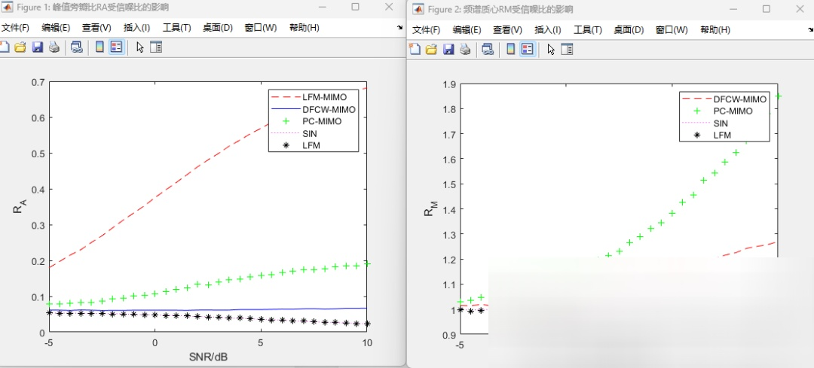

# Effect of LFM-MIMO, DFCW-MIMO, PC-MIMO, SIN, and LFM Signal-to-Noise Ratio on Peak Sidelobe Ratio (RA) [with MATLAB Code]

Function: To calculate the peak sidelobe ratio (RA) and low-high frequency mean ratio (RM) of five signals under different signal-to-noise ratios.
DFCW_RA_SNR.m  
Function: Generates orthogonal discrete frequency coded signals and calculates the peak sidelobe ratio (RA) and low-high frequency mean ratio (RM).
LFM_RA_SNR.m  
Function: Generates linear frequency modulated signals and calculates the peak sidelobe ratio (RA) and low-high frequency mean ratio (RM).
OFDMLFM_RA_SNR.m  
Function: Generates orthogonal frequency division linear frequency modulation signals and calculates the peak sidelobe ratio (RA) and low-high frequency mean ratio (RM).
PC_RA_SNR.m  
Function: Generates orthogonal phase-encoded signals and calculates the peak sidelobe ratio (RA) and low-high frequency mean ratio (RM).
SIN_RA_SNR.m  
Function: Generate single-carrier signals and calculate the peak sidelobe ratio (RA) and low-high frequency mean ratio (RM).
Input parameters:
vSNR: Signal-to-Noise Ratio Vector
Output:
RA: Peak sidelobe ratio vector RA, corresponding to signal-to-noise ratio vector
RM: Low-High Frequency Mean Vector RM, Corresponding to the Signal-to-Noise Ratio Vector
calculateRA.m:  
Function: Calculate the peak sidelobe ratio (RA) and low-high frequency mean ratio (RM) under different signal-to-noise ratios, refer to Section 3.4.5 in the reference paper.
Input parameters:
SIGS: Input signals, which can be multi-line MIMO signals, will be merged into a single line signal during the computation.
vSNR: Signal-to-Noise Ratio Vector
Output:
RA: Peak sidelobe ratio vector RA, corresponding to signal-to-noise ratio vector
RM: Low-High Frequency Mean Vector RM, Corresponding to the Signal-to-Noise Ratio Vector
sig_dfcw.m  
Function: Generate orthogonal discrete frequency coded signals.
sig_ofdm.m  
Function: Generates orthogonal frequency division multiplexed linear frequency modulated signals.
sig_pc.m  
Function: Generates orthogonal phase-encoded signals.
MATLAB simulation results

## Images

<!-- PAYMENT_BLOCK -->

## Get this dataset

- Payment link (Stripe): [Buy now](https://buy.stripe.com/3cs8yP7sY87d0vu9AB)
- Payment QR code: 

<!-- /PAYMENT_BLOCK -->
